# Cello from Scratch

I've played the cello for 10 years. For this project I built a neural audio codec, an expressive performance model and a symbolic
composer for solo cello. I trained them from scratch on about 12 hours of recordings and chained them so that written notes come
out as audio, without any sampled instrument. Every model was judged by ear as well as by the numbers.

## The problem: sound is dense

A photo looks sharp only when it has millions of pixels. Sound works the same way, except the pixels arrive in a stream. To capture
everything up to 12 kHz, a recording needs **24,000 samples every second**, and the ear notices if any of them are wrong:
- **Timing to a few milliseconds:** a bow attack is over in about 20 ms.
- **Pitch to about 5–10 cents:** a cent is 1/100 of a semitone.
- **Spectral shape:** the balance of energy across frequencies, which is most of what makes a cello sound like a cello rather than a
  viola.

A single cello note is already a lot of structure:
- a fundamental plus a stack of harmonics; the open C string at 65 Hz has over 180 of them below 12 kHz
- each harmonic with its own rise, decay and wobble under vibrato
- broadband bow noise, resonances of the wooden body, and the room

Three minutes of mono audio is about **4.3 million numbers**, roughly a 4-megapixel image. Raw 16-bit audio at this rate is
384 kbit/s.

Almost all of that is **redundant once you know two things**:
- **That it's a cello.** How a bowed string vibrates, how the body colours it, what bow noise sounds like. This doesn't change from
  second to second, so a model can learn it once and store it in its weights.
- **The context.** Which note, how loud, how bright, how much vibrato, where the bow changes. This is the part that actually carries
  information, and it changes slowly compared with the waveform.

## The key idea: an encoder–decoder

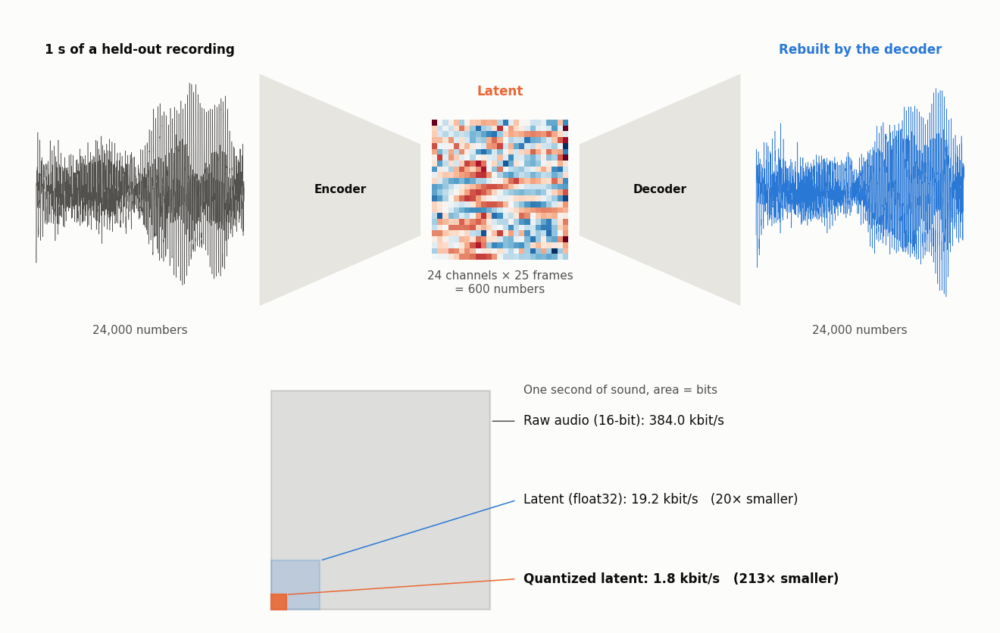

An **encoder–decoder** (autoencoder) is two networks trained together:
- The **encoder** squeezes the input into a small code, the **latent**.
- The **decoder** rebuilds the input from that code alone.

Training only asks that what comes out matches what went in. The latent is far smaller than the input, so the encoder has to learn
which details matter: here, the context. The decoder learns to supply everything else, the cello itself. Mine is trained
adversarially, as a GAN, so the detail it supplies is realistic cello texture rather than a blurred average (more below).

The figure above is one real second of the held-out recording. The encoder turns 24,000 samples into 600 numbers. The decoder turns
those 600 numbers back into 24,000 samples. Quantized, the latent is **213× smaller** than the raw audio.

This architecture is behind most of modern generative AI:
- **Images:** [latent diffusion](https://arxiv.org/abs/2112.10752) (Stable Diffusion) encodes a 512×512 image, 786,432 numbers,
  into a 64×64×4 latent of 16,384 numbers, 48× fewer. It does all of its generation in that space, and a decoder turns the result
  back into pixels. [VQ-VAE](https://arxiv.org/abs/1711.00937) and [VQGAN](https://arxiv.org/abs/2012.09841) encode images as grids
  of discrete tokens, which is how the [first DALL·E](https://arxiv.org/abs/2102.12092) generated images with a language model.
- **Language:** the [Transformer](https://arxiv.org/abs/1706.03762) was introduced as an encoder–decoder for translation: encode
  the English sentence, decode it in French. Today's LLMs keep the decoder half but still work on a compressed representation. Text
  is split into tokens, and each token becomes a vector of learned numbers.
- **Sound:** neural codecs ([SoundStream](https://arxiv.org/abs/2107.03312), [EnCodec](https://arxiv.org/abs/2210.13438),
  [DAC](https://arxiv.org/abs/2306.06546)) bring the same idea to audio, and music generators like
  [MusicGen](https://arxiv.org/abs/2306.05284) generate codec tokens instead of raw samples.

In this project the codec is the foundation everything else stands on. The decoder can turn 600 numbers a second back into cello,
so every model above it works in a space 40× smaller than the waveform and far more meaningful: the performance model, the latent
model and, through them, the composer. Generating a second of cello means writing 600 numbers, not 24,000.

The rest of the chain continues the same pattern. Each stage keeps only the context and leaves the rest to a learned model, so each
step down is a smaller, slower description of the same music:

| Level | What it describes | Numbers per second | Bit rate |
|---|---|---|---|
| Waveform | air pressure, sample by sample | 24,000 | 384 kbit/s (16-bit) |
| Codec latent | the sound, frame by frame (24 channels × 25 Hz) | 600 | **1.8 kbit/s** quantized (**213× smaller**) |
| Control curves | pitch, loudness, brightness, noisiness, voicing (5 × 25 Hz) | 125 | |
| Notes | pitch, onset and duration of each note | a few per note | |

Going down the table is **compression**: the codec encoder squeezes the waveform into 600 numbers a second. Going up is
**generation**:
- the composer writes notes
- the performance model turns them into curves
- the latent model fills in the sound frame by frame
- the decoder renders the 24,000 samples a second

Each model only has to supply the detail that the level above it leaves out.

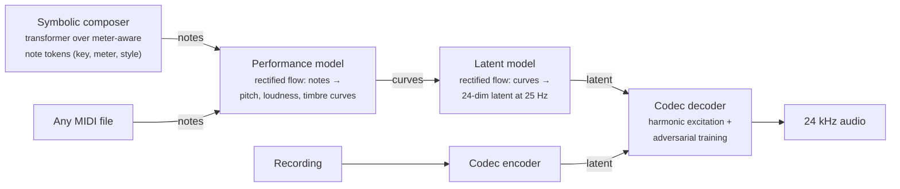

Every number on this page comes from **a held-out recording the models never trained on**: Mischa Maisky's Bach Cello Suite No. 2.

## Key results

| | Result |
|---|---|
| **Codec pitch accuracy** | **7 cents** median error on held-out audio (a cent is 1/100 of a semitone; trained listeners notice about 5–10) |
| **Codec bit rate** | **1.8 kbit/s** with a 12-stage residual vector quantizer, at 8 cents. That is roughly 1/70 of a 128 kbit/s MP3 |
| **Note edges (adversarial decoder)** | Note endings decay at **−3.3 dB per 10 ms**, against −3.6 in real playing and −2.4 before adversarial training |
| **Dynamics kept** | **94%** of slow amplitude movement (bowing, vibrato) vs **25%** for the spectrogram + Griffin-Lim baseline I started from |
| **Latent predictability** | Unpredictable share of the latent cut from **11.4% to 5.4%**, while reconstruction *improved* (0.797 → 0.788 spectral error) |
| **Rendering from curves** | **6.4 cents** median pitch error, 93% of frames within 50 cents |
| **Notes → performance** | **93–94%** of the audio within 50 cents of the written notes; vibrato at **6.1–6.4 Hz, ±10 cents**, matching measured cellists |
| **Composition** | **95–100%** of notes in key; never more than **16 notes** copied in a row from any single training melody |

## Listen

| Clip | What it is |
|---|---|
| [Original](docs/assets/audio/1_original_maisky.mp4) | 12 s of the held-out Maisky recording |
| [Codec reconstruction](docs/assets/audio/2_codec_reconstruction.mp4) | The same 12 s, encoded to 24 numbers per 40 ms and decoded |
| [Performed from notes](docs/assets/audio/3_performed_from_notes_maisky.mp4) | Only the *notes* of that passage, extracted automatically. The performance model chooses the pitch bends, vibrato and dynamics |
| [Composed: air, D minor 3/4](docs/assets/audio/4_composed_air_dminor.mp4) | Written by the composer, played by the rest of the chain |
| [Composed: air, G major 4/4](docs/assets/audio/5_composed_air_gmajor.mp4) | |
| [Composed: chorale style, D minor](docs/assets/audio/6_composed_chorale_dminor.mp4) | |
| [Composed: suite style, G major](docs/assets/audio/7_composed_suite_style_gmajor.mp4) | Conditioned on the Bach-suite style token |

GitHub plays these mp4s when you click them. [`tour.ipynb`](tour.ipynb) has inline players plus every figure below.

---

## How it works

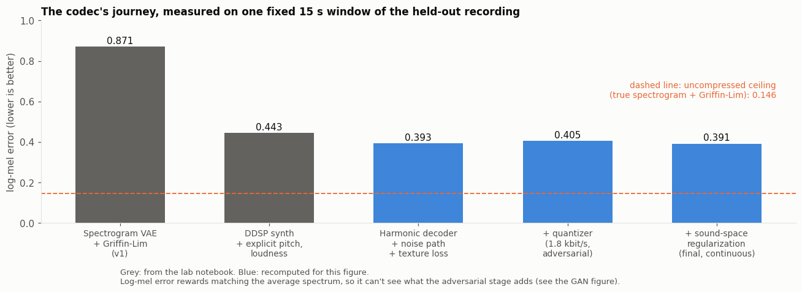

*Each codec version on the same 15 s of the held-out recording. Switching from spectrogram + Griffin-Lim to a synthesizer-based
decoder halved the error. The later steps barely move this number but changed the sound a lot (quantizing to 1.8 kbit/s costs
only 0.012). Log-mel error measures the average spectrum, so it can't see what adversarial training adds; the GAN figure below
shows that.*

### 1. The codec: 24 numbers, 25 times a second

An encoder compresses 24 kHz audio into a 24-dimensional latent vector every 40 ms. The decoder doesn't predict a spectrogram.
It drives a **bank of phase-locked sine oscillators at the harmonics of the pitch it reads from the latent**, predicts how loud each
harmonic should be, and adds a learned noise path for bow texture.

**Why the decoder is a GAN.** The latent keeps the *shape* of the sound: pitch, loudness, spectral balance and how they move. It
can't keep the exact *microstructure*: the grain of the bow, the tiny irregularities in each cycle, the crispness of a note
starting and stopping. That information is lost in compression.
- **Reconstruction losses alone fail here.** A loss like spectral or mean-squared error gets its best score by predicting the
  *average* of every waveform that fits the latent. Averaging many slightly different bow textures cancels them out, so the result
  is smooth, blurred and too clean. That is exactly what I heard: it sounded hollow and the gaps felt too clean.
- **A discriminator fixes it.** I added networks trained to tell real cello from decoded cello. The decoder is rewarded for
  fooling them. It no longer has to match the original sample by sample, only to produce microstructure a real cello could have
  produced.
- **It helps the parts the ear cares about and costs little elsewhere.** The ear is insensitive to exact waveform phase and very
  sensitive to texture and transients. This is the perception–distortion tradeoff ([Blau & Michaeli 2018](https://arxiv.org/abs/1711.06077)):
  at a fixed bit rate you can't minimize sample-level error and maximize realism at once. At 1.8 kbit/s, realism is the one worth
  having.

I used two kinds of discriminator, as in HiFi-GAN, BigVGAN and DAC:
- **Multi-period:** reshapes the waveform at several periods, to judge whether each cycle repeats the way a bowed string does.
- **Multi-band STFT:** judges texture across time and frequency.

A feature-matching loss keeps training stable. The reconstruction losses stay on to hold the shape, while the discriminators
supply the detail.

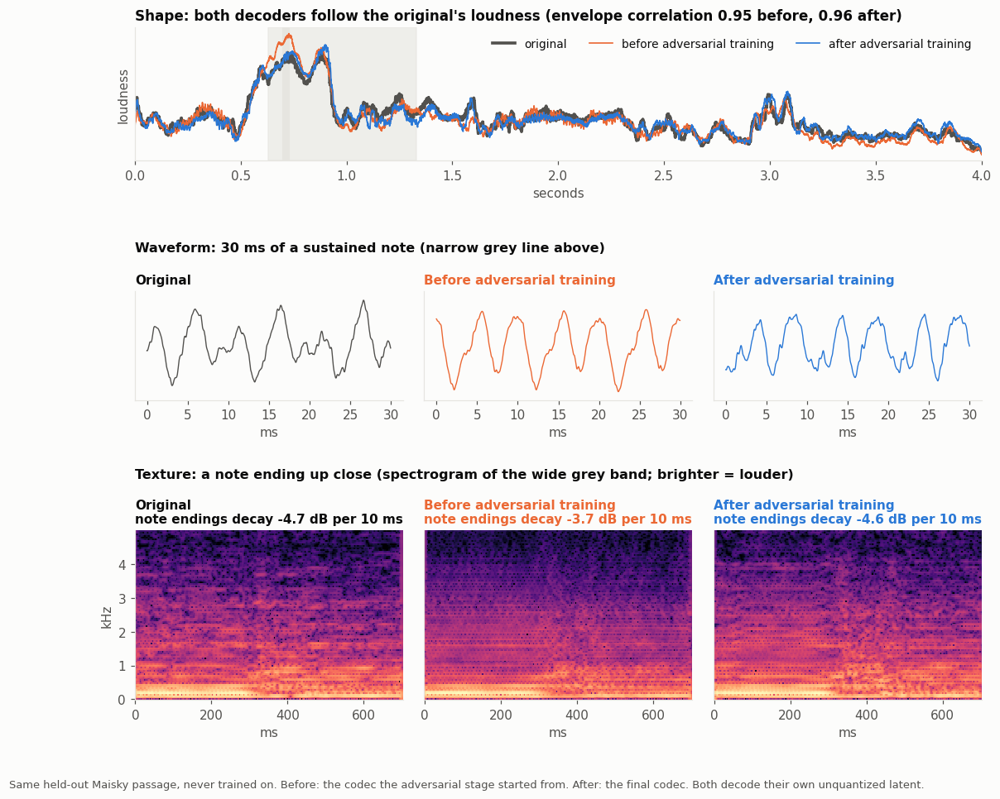

*The same held-out passage decoded by the codec just before adversarial training and by the final codec.*
- **Shape (top):** both follow the original's loudness almost equally well, with envelope correlations of 0.95 and 0.96. By that
  measure the codec before adversarial training already looks finished.
- **Waveform (middle):** zoomed to 30 ms, the difference is plain. The original's cycles are jagged with fine detail. Before
  adversarial training they are smoothed toward sine waves, the averaging blur in action. After, the detail is back. It isn't the
  *same* detail as the original sample for sample, but it is the right kind.
- **Texture (bottom):** before adversarial training the spectrogram has a regular, combed pattern and smeared note edges. After,
  the texture and the note ending look like the original's: notes end at −4.6 dB per 10 ms, against −4.7 in the original and −3.7
  before.

Listen: [before adversarial training](docs/assets/audio/9_before_gan.mp4) · [after](docs/assets/audio/10_after_gan.mp4) ·
[original](docs/assets/audio/1_original_maisky.mp4).

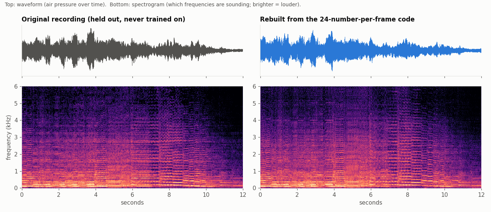

*Top: waveform. Bottom: spectrogram (time →, frequency ↑, brightness = energy). The stacked lines are harmonics. The reconstruction
keeps their spacing, their relative strengths and the vibrato wobble.*

Most design decisions came from hearing a problem and tracing it to a measurable cause:

- **It sounded hollow.** Note endings decayed at −2.4 dB per 10 ms against −3.6 dB in real playing: the averaging blur described
  above, smearing each note's edge. Adversarial training brought it to −3.3, and the difference was clearly audible even where
  the spectral metrics barely moved.
- **The gaps felt too clean.** The space between harmonics was 2.2 dB quieter than real cello. A learned noise path fills it.
- **There was a hiss in long renders.** The decoder's group normalization took statistics over the whole clip, but it had only
  trained on 4 s clips, so long renders gained about 10 dB above 6.4 kHz. Decoding in overlapping 4 s windows removed it (0.0 dB difference).
- **Honest bit rate.** Pitch is carried *inside* the latent rather than sent alongside it, so 1.8 kbit/s counts everything the decoder
  needs.

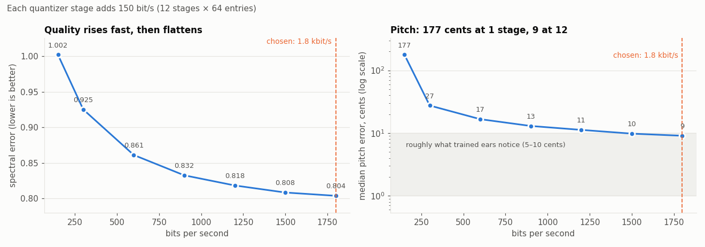

*Quality against bit rate as quantizer stages are added (held-out validation recordings). The first few stages carry most of the
information: one stage alone leaves pitch 177 cents off, two bring it to 27. After about 1 kbit/s each stage buys little, and at
1.8 kbit/s pitch is at the edge of what trained ears notice.*

### 2. Shaping the latent space

A latent is only useful for generation if its geometry makes sense. I measured how much an equal-sized nudge to each channel changes
the sound. Before regularization, some channels moved the sound **2.3×** more than others and the pitch **9×** more.

I retrained the codec with three extra penalties:
- a path-length penalty, so equal steps produce equal changes in sound (as in StyleGAN2)
- latent noise
- a **causal predictability** penalty, so each frame is easier to predict from the past 1.8 s

I measured predictability with a **frozen predictor** that both latents had to pass the same way. The share of the latent that can't
be predicted fell from **11.4% to 5.4%**, and reconstruction improved.

My first attempt used per-channel unit variance, as in β-VAE and DIP-VAE, and it worked *against* this goal: it stretched quiet but
important channels and amplified noisy ones. Disentanglement and sound-space isometry are different objectives, so I dropped it.

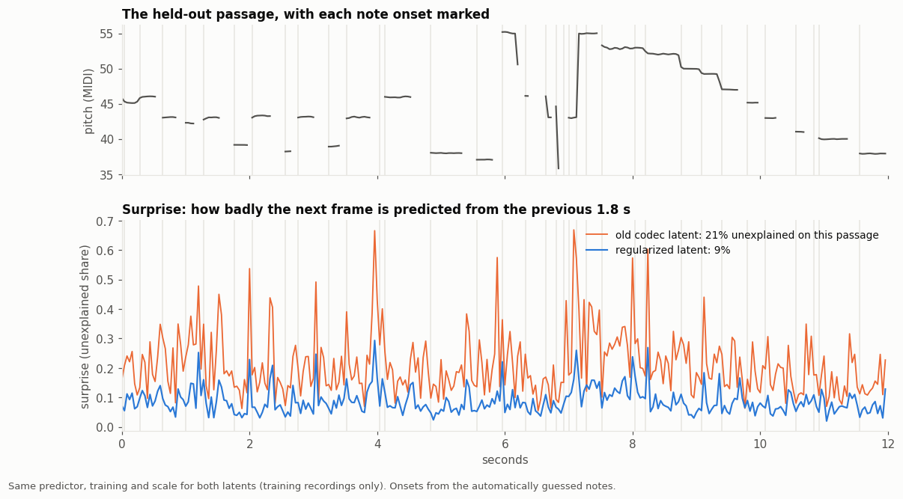

*The same causal predictor, trained the same way on each codec's latents, trying to predict the next frame of the held-out passage
from the previous 1.8 s. The old latent spikes unpredictably throughout. The regularized latent stays low: 9% unexplained on this
passage against 21%, the same halving as the 11.4% to 5.4% measured over the full test set.*

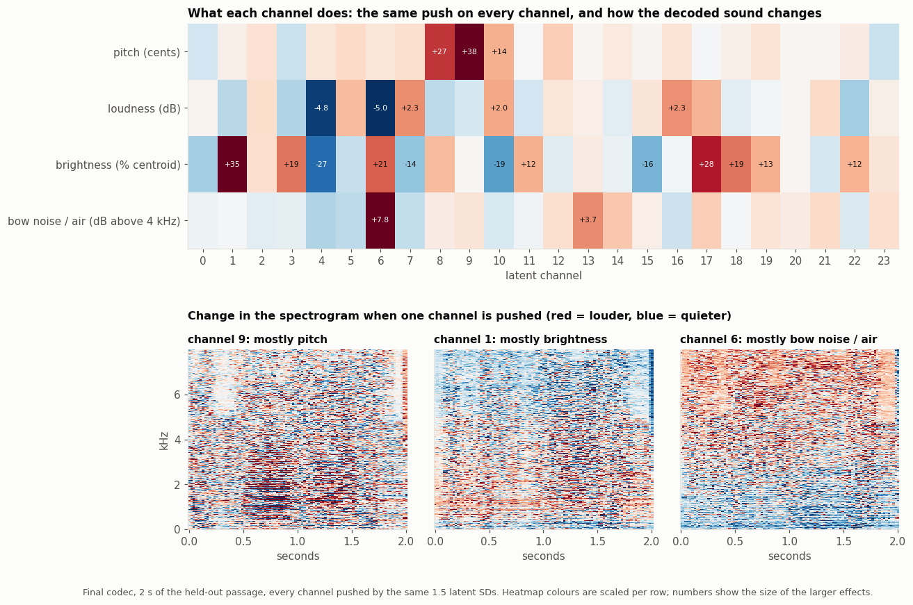

*Every channel pushed by the same amount, and what changes in the decoded sound. Pitch is concentrated in channels 8–10. Channel 6
mostly adds bow noise and air. Most other channels mix loudness and tone colour. That is expected: I regularized for equal-sized
effects (isometry), not for one meaning per channel (disentanglement).*

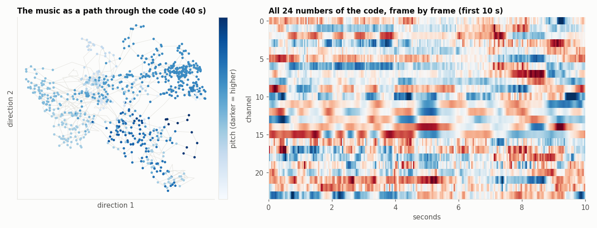

*Left: 40 s of music projected to 2D with PCA, coloured by pitch. Right: all 24 channels over time.*

**A held-out recording moving through the space.** I fit UMAP on about 50,000 frames from the training recordings (blue, darker =
higher pitch). Then I placed the unseen Maisky passage onto it frame by frame without refitting (orange). Each note change jumps to a
different neighbourhood: pitch and register organize the space.
[With audio](docs/assets/audio/8_umap_path.mp4).

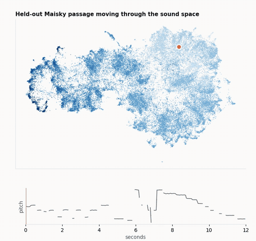

<details><summary>Whole passage, coloured by time</summary>

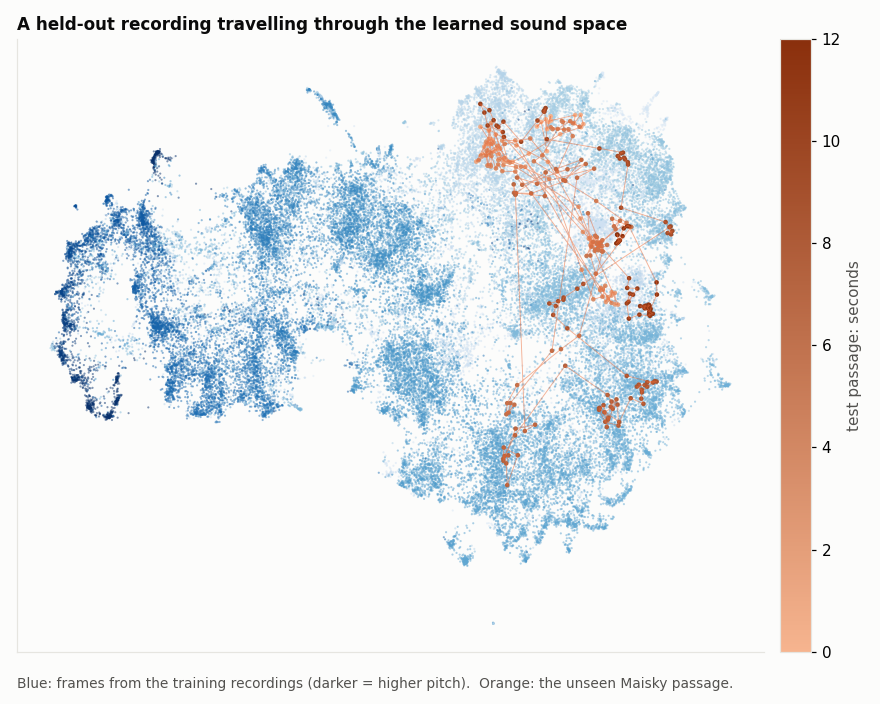

</details>

**Where each note lives.** The same map with every frame coloured by its note: hue is the note name, brightness the octave, and
saturation the pitch tracker's confidence. Large dots mark the median position of each semitone.

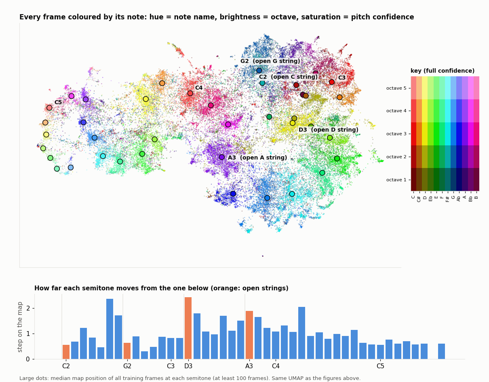

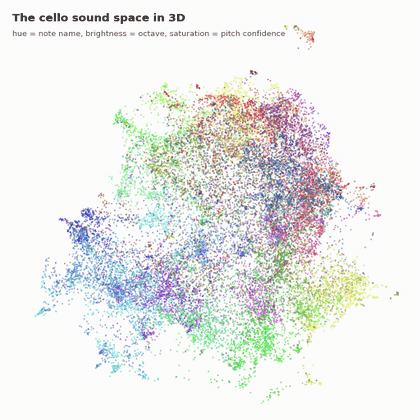

*The same colouring on a 3D UMAP of the same frames. Turned 90 degrees, then spun about the horizontal axis; the note islands keep their shape from every side. [Higher quality video](docs/assets/audio/umap3d_spin.mp4).*

- **Each note forms its own islands.** The latent was never told note names, but frames of the same note cluster together.
- **The space snakes by register.** Following the medians from D3 upward, the notes sweep across the whole map toward the highest
  notes at the far left. Below D3 they knot together in one region: down there, tone colour and bowing change the sound more than
  the note does.
- **Big steps line up with the instrument.** The bar chart shows how far each semitone's median sits from the one below. Two of the
  largest steps land on open strings, D3 and A3. An open string rings without a finger stopping it, so it sounds different from the
  stopped notes around it.

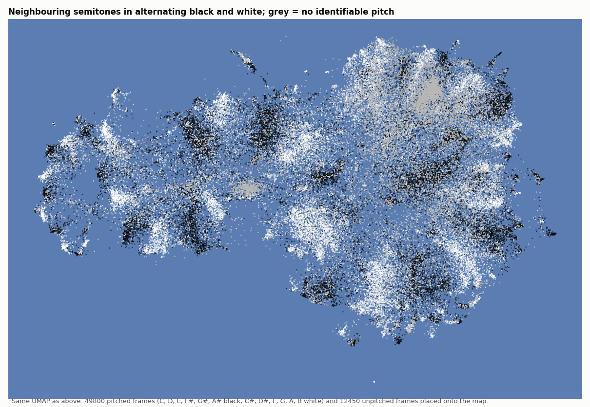

*The same map with neighbouring semitones in alternating black and white. The stripes show the snake directly: every step up in
pitch moves to the next band. Grey frames have no identifiable pitch (bow noise, attacks, silence between notes); they gather in a
few distinct regions of their own.*

The lowest median, B1, is below the cello's range; it comes from pitch-tracker errors and flat low notes in the training audio.

### 3. From curves to latent, and from notes to curves

Two **rectified-flow transformers** do the generation. Rectified flow is a diffusion-style model that learns straight paths from noise
to data, sampled here with a second-order Heun solver.
- The **latent model** maps five control curves (pitch, loudness, brightness, noisiness and voicing) to the 24-dim latent.
- The **performance model** maps notes to those curves. It learns only *expression* (bends, swells, vibrato), because the notes fix
  *what* is played.

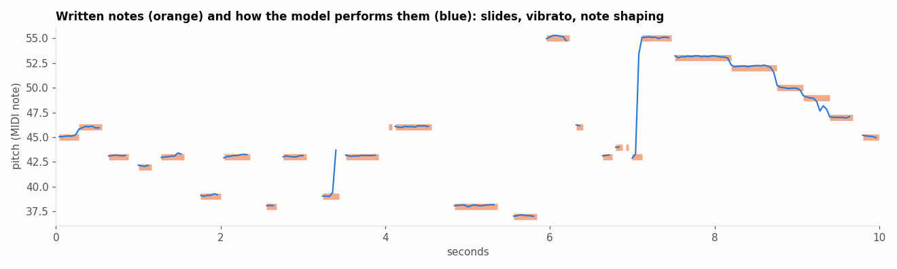

*Orange: the written notes. Blue: the pitch the model performs, with scoops into notes, vibrato and releases.*

Two earlier approaches didn't hold up:
- **Discrete tokens.** I first built a token pipeline: residual-VQ codebooks, a MusicGen-style delay-pattern transformer and
  scheduled sampling. Generated token sequences moved **2×** more per frame than real ones, and the fine codebook stages were close
  to random (5–5.8 of 6 bits). Continuous latents fixed the continuity immediately, in line with Kyutai's 2025 results on continuous
  audio language models.
- **Learned vibrato.** The flow models produce realistic vibrato, but on only 2–3% of long notes against 12% in real playing,
  because the model hedges on *whether* a note gets vibrato. I made that decision explicit: each note gets vibrato with the measured
  probability and a measured shape.

### 4. The composer

A 14.7M-parameter transformer over **meter-aware tokens**:
- a header for style, time signature and key
- then, for each note, a bar line, its position in the bar on a 1/12-beat grid, its pitch and its duration

It is pretrained on about **1 million notes** of public-domain folk melodies and Bach chorale voices, then fine-tuned on the Bach
cello suites.

My first version learned from notes transcribed out of the audio, and it sounded like it jumped around. The data explained why: 20% of intervals
were octave-plus leaps and 22% of notes were sub-80 ms blips, both artifacts of transcription, and there was no meter. Clean symbolic
data fixed it.

Sampling uses **Mirostat** (a target surprisal per token) to trade predictability against variety. A copy audit, calibrated on real
held-out music, caps verbatim reuse at 16 notes.

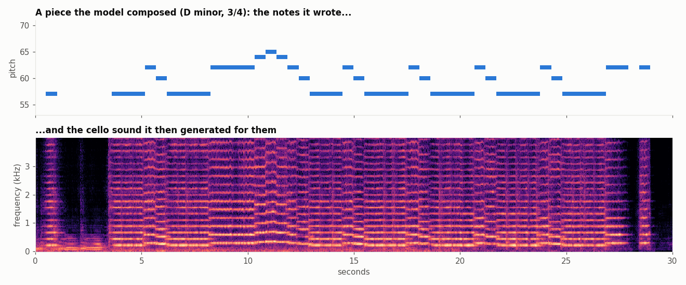

---

## What I'd do next

- Predict per-note dynamics and vibrato directly in the composer instead of with rules.
- Add phrase and section-level structure (repeats, return of the opening theme) without hand-written form templates.
- Turn the halved unpredictability into real bits with a predictive quantizer.
- Retrain the same pipeline on violin, viola or voice.

## Compute

Everything here trains locally on a single RTX 3060 (12 GB). For speed I optionally ran the longer jobs on Colab.

## Repository

| Path | |
|---|---|
| [`docs/TECHNICAL.md`](docs/TECHNICAL.md) | Full write-up: every design decision, its measurement and the literature behind it |
| [`docs/REFERENCES.md`](docs/REFERENCES.md) | Papers used, by stage |
| [`v2/LAB_NOTEBOOK.md`](v2/LAB_NOTEBOOK.md) | Chronological lab notebook, including dead ends and retracted results |
| `colab/cello_gan/` | Codec (`train_gan.py`, `train_rvq.py`, `train_reg.py`), flow models (`train_lat.py`, `train_curve.py`), composer (`train_symlm.py`, `gen_sym.py`), full chain (`midi_to_audio.py`) |
| `v2/` | Earlier codec research: DDSP and harmonic decoders, encoder studies, evaluation tools |

```bash
cd colab/cello_gan
STYLE=folk KEY="D minor" METER=3/4 BARS=24 BPM=58 TAU=0.6 python gen_sym.py <composer.pt> piece.mid   # compose
VIB=0.6 python midi_to_audio.py <codec.pt> <latent_model.pt> <curve_model.pt> piece.mid piece.wav      # perform
```

## Data and credits

- **Audio:** 89 solo-cello performances from YouTube (about 12 hours), used for non-commercial research. Training audio is not
  redistributed; every recording is credited and linked in [`docs/SOURCES.md`](docs/SOURCES.md).
- **Symbolic:** public-domain collections bundled with [music21](https://web.mit.edu/music21/), and the Bach cello suites from the
  [Mutopia Project](https://www.mutopiaproject.org/) (some movements CC BY-SA 3.0).
- **Papers:** every paper used, grouped by stage with what I took from each, in [`docs/REFERENCES.md`](docs/REFERENCES.md).
